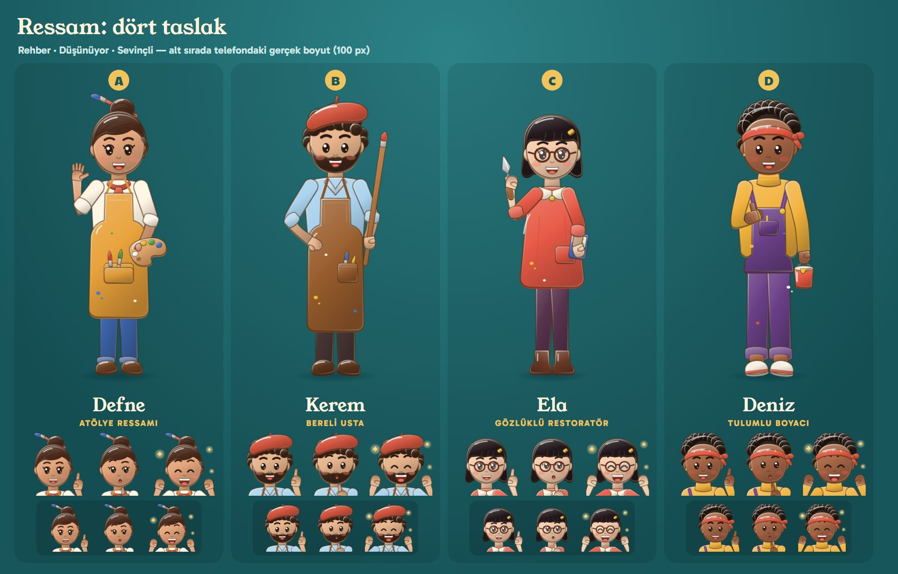
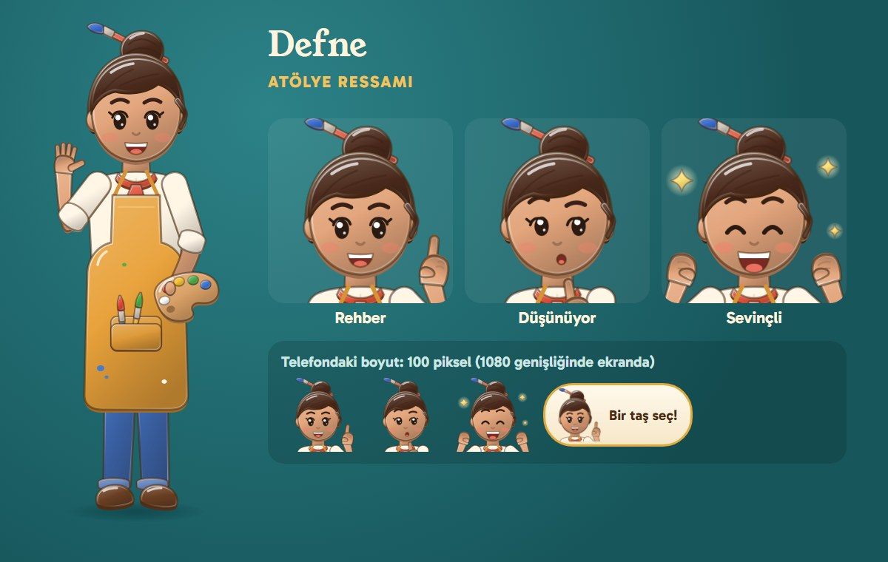
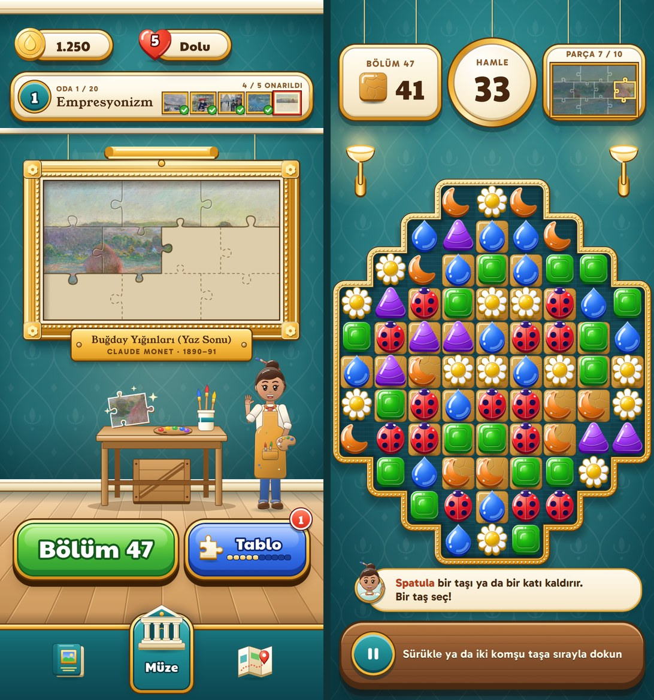
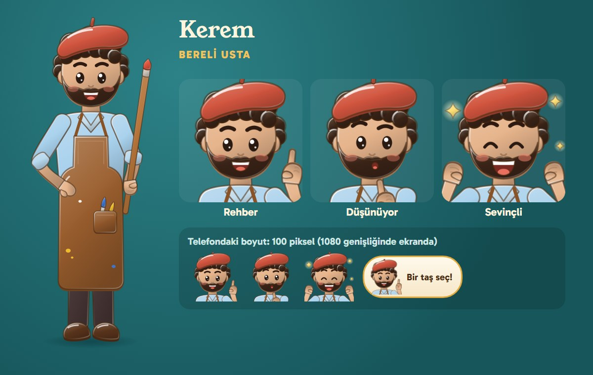
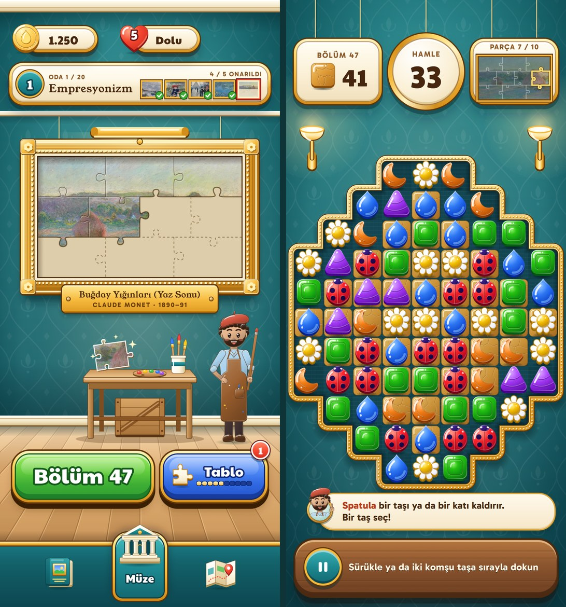
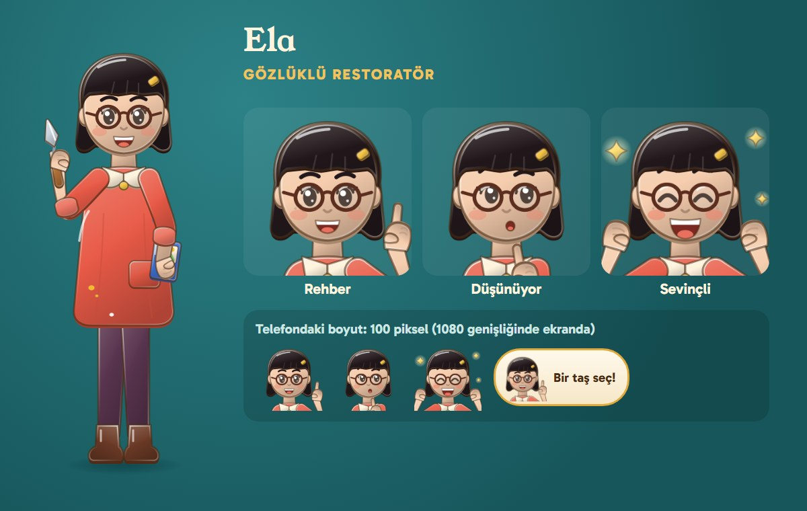
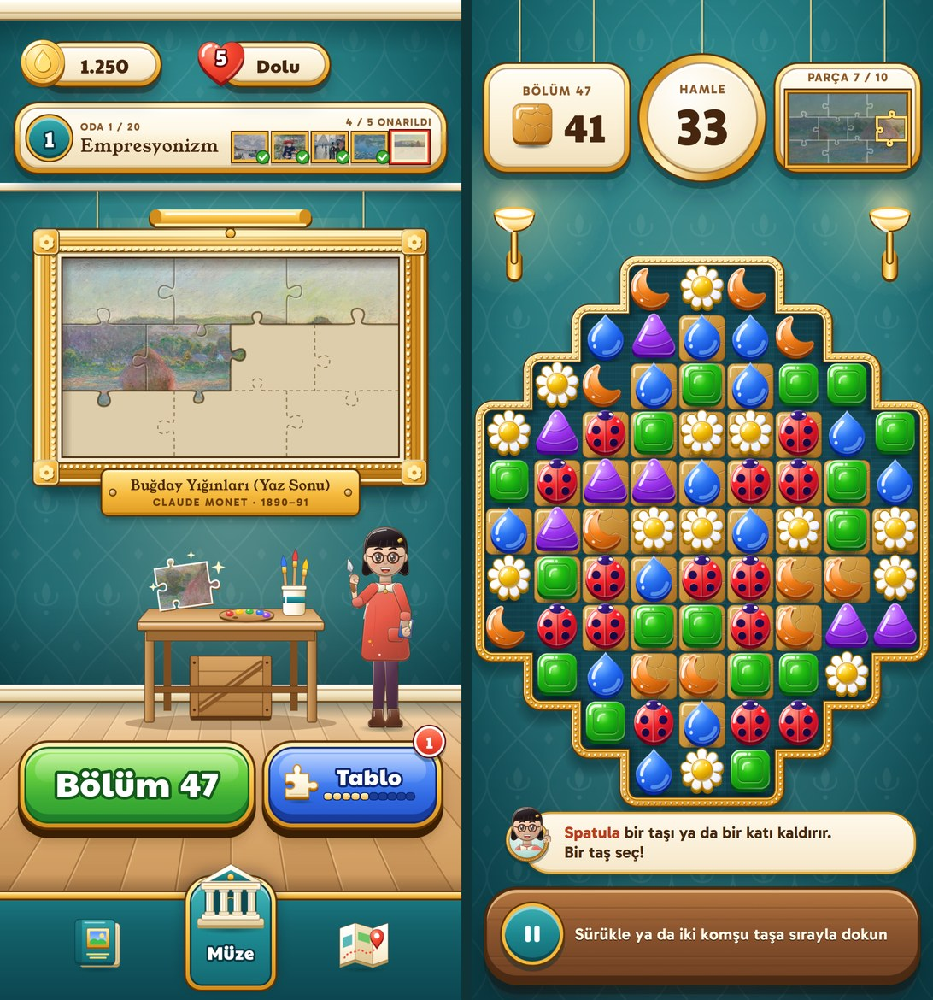
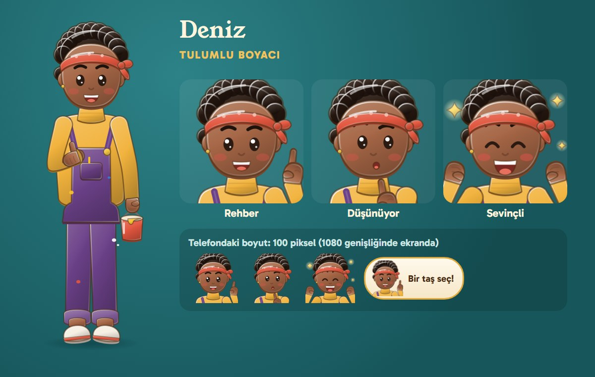
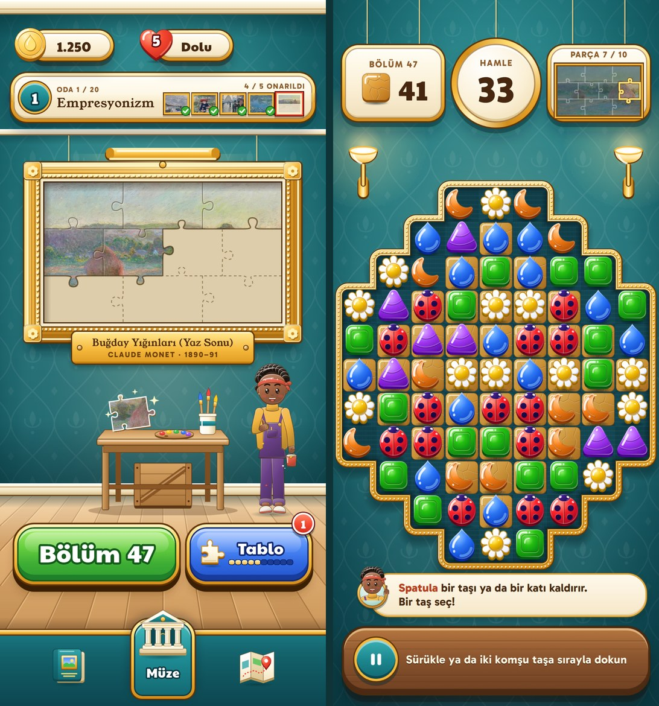

# Ressam Avatarı: Dört Taslak

> 2026-10-15. Oyunun yüzü olacak genç ressam için dört taslak. Sahibi bugün avatar kararını verdi: ressam
> müzenin salonunda tezgâhın yanında durur, rehberlerde (öğretici adımlar ve her booster'ın ilk kullanımı)
> konuşma balonunda tek cümle söyler, kazanma kartında ve oda açılınca sevinir. Bu belge seçim içindir;
> çizimler son sanat değil, taslaktır. Hepsini bir yapay zekâ ajanı tasarım tuvalinin ışık tarifiyle
> (yan kalınlık, yüz gradyanı, form gölgesi, iki kenar ışığı, tek beyaz parlama, sıcak kontur) SVG olarak
> çizdi. Başka oyunun görseli indirilmedi, kopyalanmadı. Hikâye: [GAME_DESIGN.md §18](../GAME_DESIGN.md).
> Dosyalar: `out/avatar-concepts/` (depoda izlenmiyor). Her taslağın klasöründe ayakta duran figür
> (`full.svg`, 3:7) ve üç ifadeli büst (`bust-friendly`, `bust-thinking`, `bust-delighted`) SVG ve PNG
> olarak var. Yeniden üretmek için `py out/avatar-concepts/tools/render.py export`, ardından
> `py out/avatar-concepts/tools/mockups.py`.

## 1. Dördü bir arada

Her sütunda ayakta duran figür, üç ifade (rehber, düşünüyor, sevinçli) ve altta aynı büstler telefondaki
gerçek boyutta: 1080 piksel genişliğindeki ekranda 100 piksel.

Maketlerde soldaki ekran salondur (Unity'nin 7. aşama görüntüsü, figür tezgâhın sağında), sağdaki ekran
oyun tahtasıdır (9. aşama görüntüsü). Balondaki büst yaklaşık 110 pikseldir. Altın çerçeveli küçük bir
madalyonda durur, başı ve eli çerçeveden taşar. Balon yazısı Gabarito, boyutu oyunun düğme yazılarına yakın.

## 2. A — Defne, atölye ressamı

Defne, 24 yaşında, müzenin atölyesinde çalışan sıcak ve becerikli bir ressam: saçını bir fırçayla topuz yapmış, hardal önlüğü ve paletiyle el sallayarak salonda "hoş geldin" diyen bir ev sahibi gibi duruyor. Hardal, krem ve mercan oyunun altın plaketleri, krem kartları ve kırmızı kalpleriyle aynı aileden; teal duvarda en çok o parlıyor ve 30 yaş üstü sakin oyuncuya tanıdık, güvenilir bir yüz sunuyor.

## 3. B — Kerem, bereli usta

Kerem, 27 yaşında, uzun boylu bir ressam: kısa sakalı, kıvırcık saçları, kiremit rengi beresi ve fırça dolu deri önlüğüyle elinde boyu kadar bir fırça tutuyor. Bere "ressam" demenin en kısa yolu; küçük boyutta dördünün en kolay tanınan silueti onunki, ama bereli sakallı ressam aynı zamanda bir klişe.

## 4. C — Ela, gözlüklü restoratör

Ela, 23 yaşında, ufak tefek ve titiz bir restoratör: kâküllü siyah küt saçları, yuvarlak gözlüğü ve mercan önlüğüyle elinde Spatula booster'ının aynısı bir palet bıçağı, koltuğunun altında bir eskiz defteri taşıyor. Gözlük ve küt saç küçük boyutta çok net bir yüz kuruyor; "parçaları dikkatle yerine koyan kişi" fikri oyunun yapbozuna en çok onda oturuyor.

## 5. D — Deniz, tulumlu boyacı

Deniz, 26 yaşında, iri yapılı ve enerjik bir ressam: kıvırcık saçlarına mercan bir bandana bağlamış, hardal kazağın üstüne boya lekeli mor bir tulum giymiş, bir elinde boya kovası, öbüründe kalkık bir baş parmak. Adı da görünüşü de cinsiyet açısından nötr, her oyuncu kendini onda bulabilir; duruşu "birlikte yaparız" diyen bir takım arkadaşı gibi okunuyor.

## 6. Karşılaştırma

| | A — Defne | B — Kerem | C — Ela | D — Deniz |
|---|---|---|---|---|
| Küçük boyutta okunurluk | İyi: topuz ve içindeki fırça başı tanıtıyor, yüz açık | En iyi: bere ve sakal 100 pikselde bile ilk bakışta okunuyor | Çok iyi: gözlük ve küt saç net. Gözler gözlüğün içinde küçülüyor | İyi: bandana belirgin. Koyu ten koyu duvarda kenar ışığına muhtaç, açık zeminli madalyonda sorun yok |
| Teal duvarda duruş | En iyi: hardal, krem ve mercan duvarın tam karşıtı | Orta: açık mavi gömlek duvara yakın renk, beresi ve önlüğü taşıyor | Çok iyi: mercan önlük duvarda güçlü bir leke | İyi: hardal kollar parlıyor, mor tulum koyu kalıyor |
| Animasyon | Kolay ve zengin: topuz ve fırça hafif sallanır, el sallama doğal, önlük salınır | Kolay: bere ve sakal katı parçalar. Sakal ağız hareketini biraz saklar | Orta: başı her döndüğünde gözlük de dönmeli. Küt saç güzel sallanır | Kolay: kıvırcık saç tek kütle, bandananın uçları dalgalanır |
| Risk | Düşük. En "güvenli" seçim; ayırt ediciliği topuz ve önlüğe bağlı | Bereli, sakallı ressam bir klişe. Oyuncu kitlesinin büyük bölümü kadın olan bir türde yalnız erkek yüz | Gözlük her pozda ek çizim işi. Ufak yapı fazla genç okunmasın diye kıyafet yetişkin tutuldu | Nötr sunum bazı oyunculara "kim bu?" dedirtebilir. Koyu ten için ışık ayarı her ekranda kontrol edilmeli |

## 7. Önerim

**A — Defne.** Üç nedenle:

1. **Ekranla aynı aileden.** Teal duvarda en çok o parlıyor: renkleri zaten oyunun plaketlerinde, kartlarında ve
   kalplerinde var, yeni renk getirmiyor.
2. **Bir ev sahibi gibi duruyor.** El sallaması salonda hoş geldin demeye uygun. Topuzdaki fırça ve önlük
   "ressam" diyor ama bere klişesine düşmüyor.
3. **Kitleye uyuyor.** 30 yaş üstü, çoğunluğu kadın olan sakin oyuncu kitlesine sıcak geliyor, kimseyi dışarıda
   bırakmıyor. Animasyonu da en ucuzlarından.

İkinci tercihim **C — Ela**. Palet bıçağı ve "parçaları dikkatle yerleştiren" kimliği hikâyeye en iyi oturan
taslak. Bedeli her pozda gözlük çizmek. Kerem'in beresi, ikinci bir karakter (örneğin müzenin emektar küratörü)
gerekirse iyi bir aday.

## 8. Notlar ve açık noktalar

- **Salondaki yer.** Figür, Unity ekranında boş olan tezgâhın sağında duruyor. Tasarım tuvalinde orada
  "Hediye" çerçevesi, solda etkinlik çerçevesi asılı. İkisi oyuna gelince figür ya biraz küçülür ve çerçevenin
  altında kalır ya da çerçeve yukarı alınır. Karar seçimden sonra verilir.
- **Balon.** Altın madalyonlu krem balon bir öneri. Balon tahta ile alt raf arasında, raftaki ipucu yazısının
  üstünde duruyor. Booster'ın ilk kullanımında tahtanın kararması ve hedef taşın vurgulanması ayrıca çizilecek.
- **Seçimden sonra.** Seçilen taslak için: renk ve oran temizliği, önden ve dörtte üç açıdan dönüş çizimi,
  kazanma kartı ve oda açılışı için iki tam boy poz (sevinç, alkış), animasyon için parçalara ayrılmış katmanlar
  (kol, el, baş, saç, göz kapakları, ağız şekilleri).
- **PDF.** Resimler `out/avatar-concepts/` klasöründen geliyor. Bu klasör depoda olmadığı için başka bir
  makinede PDF resimsiz çıkar.
